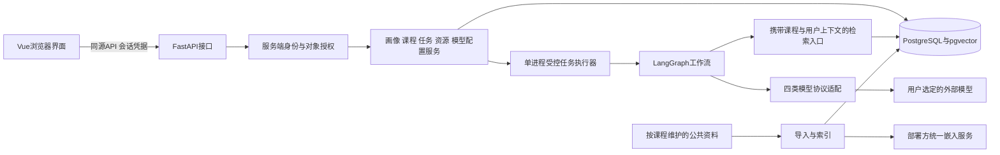
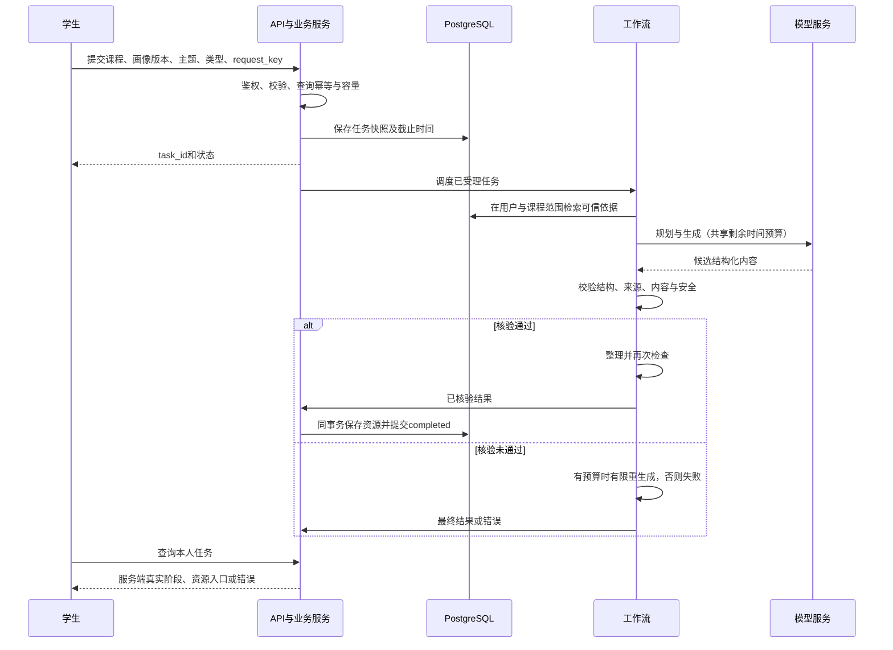
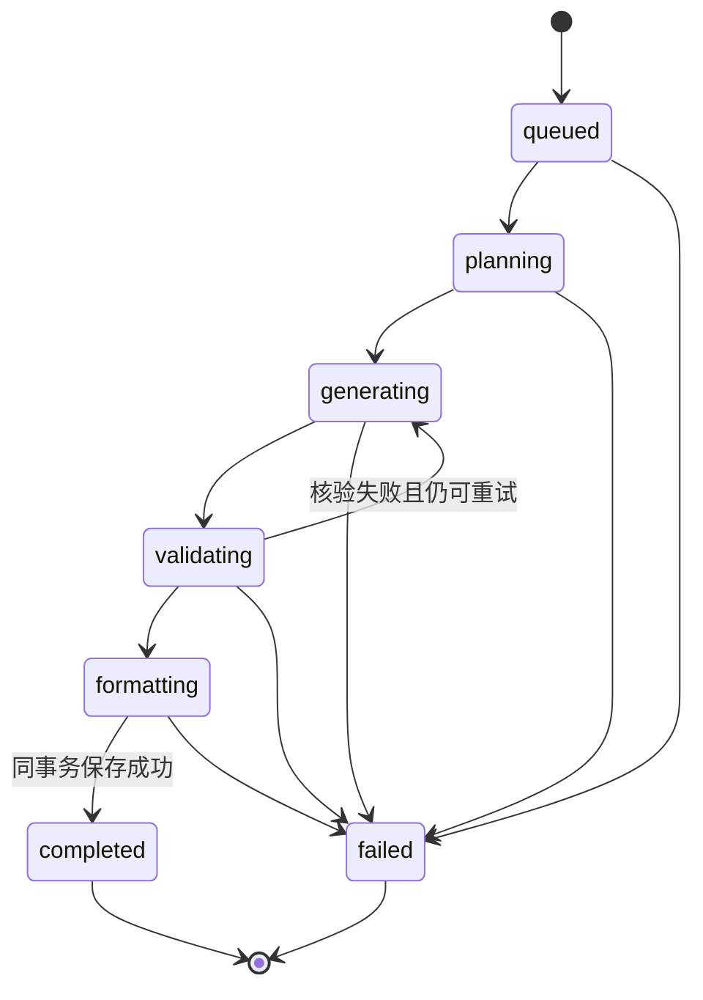

# 模块与生成流程

版本：V0.2，2026-09-27。覆盖plan中的S1-05及已确认架构。认证、每课程独立画像和YAML配置已获用户确认；具体落地见implementation-v1.md。

## 模块与信任边界

浏览器输入、模型输出、课程正文和未来上传内容均不能决定所有者或绕过授权。API从会话确定用户，服务层检查对象归属，检索限定课程及允许的可见性；模型凭据仅在服务端解密后用于所属用户的请求。

| 模块 | 拥有的责任 | 不拥有的责任 |
| --- | --- | --- |
| api | 请求校验、会话与授权入口、响应 | 自行编排模型节点 |
| services/repositories | 业务一致性、对象归属、事务和读写 | 信任客户端传入所有者 |
| tasks | 接收、限额、时限、状态、恢复 | 将未持久化结果标记成功 |
| agents/workflows与nodes | 规划、生成、核验、整理、受控纠错 | 更换用户身份或提升知识权限 |
| agents/providers | 协议转换、统一结果与错误 | 静默切换用户模型、泄露凭据 |
| agents/retrieval | 在授权范围内检索并返回可追溯依据 | 把不同用户材料混入上下文 |
| knowledge | 可共享、可定位的课程资料 | 保存个人上传和真实密钥 |

## 运行流程

内容核验失败最多两次重生成；通信补试与内容重生成分开计数。任务总时限从受理开始包含排队、调用、核验及存储。无预算时不能启动新调用，迟到结果不能改变终态。

## 状态机

所有非终态可因总时限、不可恢复故障或服务中断进入failed；completed和failed不可重新开启。手动重试创建关联原任务的新任务，默认沿用原画像快照；更换画像必须确认。

## 数据关系与存储职责

用户拥有会话、画像版本、任务、个人模型配置和资源访问权；课程关联公共资料和任务；每个成功任务对应一个资源；资源引用真实知识来源和生成时版本。任务创建后的画像、课程、主题及模型配置版本不随后续编辑回写。

资源保存与完成状态同事务；数据库唯一约束保护同用户request_key和单任务资源关系；条件更新保护终态。模型网络调用不持有长数据库事务。表结构及两个Alembic迁移已实现，见data-dictionary.md。

后续私有资料保存于非静态运行存储，片段、向量、来源、下载和缓存都保留相同用户与课程边界。嵌入模型变更需要新索引版本，不能把不同维度或不同模型空间的向量混用。

## 当前实现状态

前后端业务、数据库、工作流与检索代码已接通。真实PostgreSQL和HTTP/模型替身测试覆盖主链路，Chrome/Edge走查通过；真实模型、真实嵌入召回和人工内容验收尚未完成。详见implementation-v1.md和测试报告，不把替身成功等同于模型质量验收。
